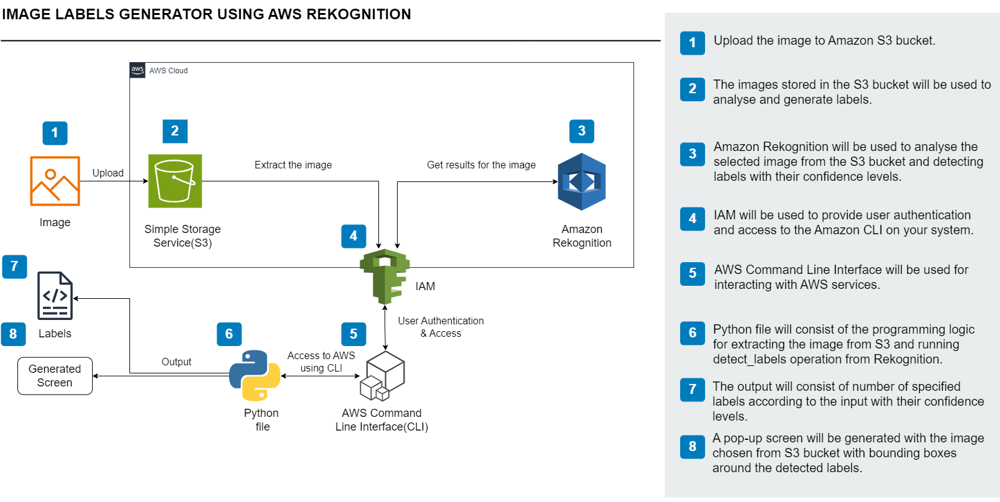

# Image Labels Generator using AWS Rekognition



> An AI-powered computer vision system designed to automatically detect, classify, and label objects within digital images using Amazon Web Services.

## 📖 Overview
This project is a cloud-based Image Labels Generator that utilizes machine learning to automatically detect and categorize objects within digital images. The workflow is driven by a Python script and the AWS CLI, which process images hosted in an Amazon S3 bucket. The core analysis is handled by Amazon Rekognition, which identifies objects and calculates confidence levels, while AWS IAM securely manages system access and authentication. The final output provides users with a visual interface displaying the analyzed image, complete with bounding boxes highlighting the detected objects and their generated labels.

## 🛠️ Tech Stack
*   **AWS S3:** Cloud storage for input images.
*   **Amazon Rekognition:** Machine learning image analysis service.
*   **AWS IAM:** Identity and secure access management.
*   **Python:** Core programming logic (using `boto3`, `matplotlib`, and `Pillow`).

## 🏗️ System Architecture
*   **Amazon S3:** Acts as the primary storage service where input images are uploaded and hosted for analysis.
*   **Amazon Rekognition:** The core machine learning service responsible for analyzing the extracted images and detecting labels alongside their confidence levels.
*   **AWS IAM:** Handles user authentication and securely manages access permissions for the AWS CLI and the associated services.
*   **Python Script & AWS CLI:** Serves as the programming logic and interaction layer. It extracts images from S3, triggers the API operation, and processes the returned JSON data.
*   **Output Generation UI:** Renders a visual pop-up screen displaying the original image overlaid with bounding boxes around the detected objects.

---

## 🚀 How to Replicate This Project

If you want to build and run this project yourself, follow these step-by-step instructions.

### 1. AWS Cloud Setup
1.  **Create an S3 Bucket:** Log into your AWS Console, navigate to S3, and create a new bucket (e.g., `image-labeler-amazon-rekognition-bucket`).
2.  **Upload an Image:** Upload a sample image (e.g., `pexels-julia-m-cameron-8841115.jpg`) to your newly created S3 bucket.
3.  **Configure IAM Permissions:** Create an IAM User with programmatic access. Attach a policy that grants the following permissions:
    *   `s3:GetObject` (to read the image from your bucket)
    *   `rekognition:DetectLabels` (to analyze the image)
4.  **Save Credentials:** Securely save the Access Key ID and Secret Access Key generated for this IAM user.

### 2. Local Environment Setup
1.  **Install the AWS CLI:** Download and install the AWS CLI for your operating system.
2.  **Configure Credentials:** Open your terminal and run the following command to authenticate your machine:
    ```bash
    aws configure
    ```
    *(Enter your Access Key, Secret Key, default region, and output format when prompted).*

3.  **Install Python Dependencies:** Set up a virtual environment (optional but recommended) and install the required libraries:
    ```bash
    pip install boto3 matplotlib pillow
    ```

---

## 💻 Code Implementation

The core logic is written in Python, utilizing the `boto3` SDK to interact with AWS services and `matplotlib` to render the visual output.

Create a file named `main.py` and add the following code:

```python
import boto3
import matplotlib.pyplot as plt
import matplotlib.patches as patches
from PIL import Image
from io import BytesIO

def detect_labels(photo, bucket):
    """
    Analyzes an image from an S3 bucket using AWS Rekognition and renders bounding boxes.
    """
    # Initialize the Rekognition client
    client = boto3.client('rekognition')

    # Call AWS Rekognition to detect labels (max 10 labels)
    response = client.detect_labels(
        Image={'S3Object': {'Bucket': bucket, 'Name': photo}},
        MaxLabels=10
    )

    print(f"Detected labels for {photo}\n") 

    # Print label information to the console
    for label in response['Labels']:
        print("Label:", label['Name'])
        print("Confidence:", label['Confidence'])
        print()

    # Load the image data directly from S3
    s3 = boto3.resource('s3')
    obj = s3.Object(bucket, photo)
    img_data = obj.get()['Body'].read()
    img = Image.open(BytesIO(img_data))

    # Prepare the image for display
    plt.imshow(img)
    ax = plt.gca()

    # Plot bounding boxes for each detected instance
    for label in response['Labels']:
        for instance in label.get('Instances', []):
            bbox = instance['BoundingBox']
            # Convert normalized coordinates to absolute pixel values
            left = bbox['Left'] * img.width
            top = bbox['Top'] * img.height
            width = bbox['Width'] * img.width
            height = bbox['Height'] * img.height

            # Draw the bounding box
            rect = patches.Rectangle((left, top), width, height, linewidth=1, edgecolor='r', facecolor='none')
            ax.add_patch(rect)

            # Add the label text and confidence score
            label_text = f"{label['Name']} ({round(label['Confidence'], 2)}%)"
            plt.text(left, top - 2, label_text, color='r', fontsize=8, bbox=dict(facecolor='white', alpha=0.7))

    # Render the final output window
    plt.show()

    return len(response['Labels'])

def main():
    # Configuration: Replace these variables with your own S3 bucket and image name
    photo = 'pexels-julia-m-cameron-8841115.jpg'
    bucket = 'image-labeler-amazon-rekognition-bucket'
    
    # Execute the detection
    label_count = detect_labels(photo, bucket)
    print("Total Labels detected:", label_count)

if __name__ == "__main__":
    main()